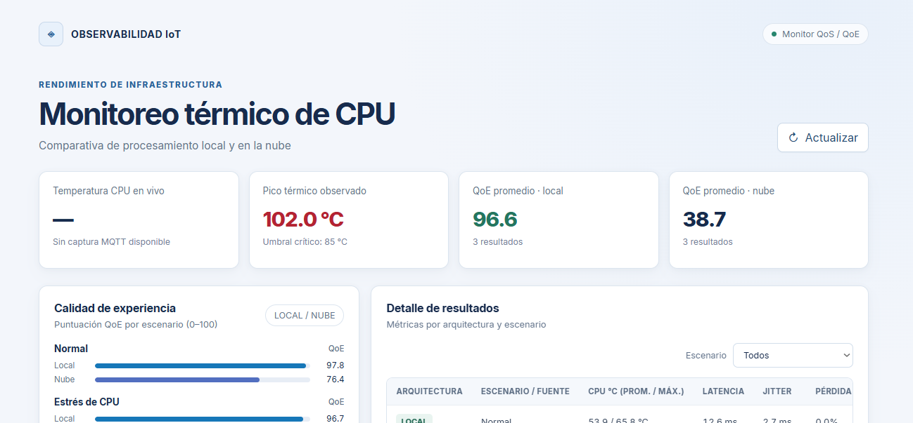
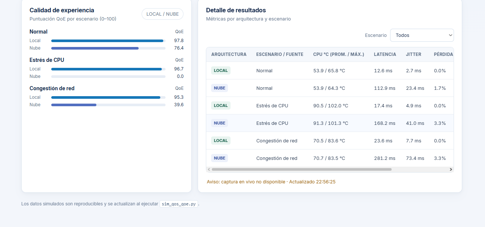

# Monitor QoS / QoE de CPU

Dashboard para comparar temperatura y calidad de servicio entre procesamiento local y en la nube. Incluye escenarios normales, estrés de CPU y congestión de red.

## Dashboard





## Publicar en Render

Para controlar MQTT desde el dashboard, despliega como **Web Service** mediante
**New > Blueprint**. Render detectará `render.yaml`; durante la configuración
define un valor secreto para `CONTROL_TOKEN`. El servicio ejecuta `server.py` y
Render inicia la compilación con `render_build.py`.

En el dashboard, escribe el mismo `CONTROL_TOKEN` y usa **Iniciar captura** o
**Detener captura**. El botón inicia o detiene juntos `subscriber.py` y
`publisher.py`; el publicador permanece activo hasta detenerlo. La página consulta
las métricas en vivo cada 10 segundos.

Render configura por defecto `test.mosquitto.org` con MQTT sobre TLS (puerto
8883), tópico `proyecto_iot/cpu/temp` y QoS 1. Para usar otro broker, cambia
`MQTT_BROKER`, `MQTT_PORT`, `MQTT_TOPIC` y `MQTT_QOS` en las variables de entorno
del servicio. Configura `MQTT_TLS=true` si el broker usa TLS; para brokers con
autenticación, añade `MQTT_USERNAME` y `MQTT_PASSWORD` como variables secretas.
Guarda los cambios y vuelve a desplegar. No pongas credenciales en el dashboard.

El broker público es compartido; usa un tópico propio y un broker con
autenticación para datos privados. Si Render reinicia el servicio, vuelve a abrir
el dashboard e inicia la captura otra vez cuando la necesites.

Los escenarios simulados se regeneran cada segundo y también al actualizar el
dashboard. La captura MQTT en vivo se actualiza al recibir mensajes del broker.

## Requisitos
- Python 3.10 o superior
- Dependencias en `requirements.txt` (`psutil`, `paho-mqtt`):
```bash
pip install -r requirements.txt
```

## Ejecutar

### 1. Simulación (escenarios reproducibles)
Desde esta carpeta, genera los resultados e inicia un servidor local:

```bash
python sim_qos_qoe.py
python -m http.server 8000
```
### 2. Captura en vivo por MQTT (Opcional)
Abrir dos terminales en la carpeta del proyecto:
```bash
# Terminal 1: suscriptor (calcula QoS/QoE y guarda results/cpu_qos_qoe.json)
python subscriber.py
# Terminal 2: publicador (envía lecturas de temperatura por MQTT)
python publisher.py --count 20
```
Por defecto se conectan al broker público `test.mosquitto.org` por el puerto
1883 (sin TLS), etiquetado como `cloud`. Se puede cambiar broker, tópico o
arquitectura con argumentos:
```bash
python publisher.py --broker localhost --arch local --count 20
```
También se pueden configurar `MQTT_BROKER`, `MQTT_PORT`, `MQTT_TOPIC`,
`MQTT_QOS`, `MQTT_TLS`, `MQTT_USERNAME` y `MQTT_PASSWORD` mediante variables
de entorno. Para un broker local, deja `MQTT_TLS=false` (valor predeterminado).
> `psutil.sensors_temperatures()` solo está disponible en Linux. En Windows, `publisher.py` estima la temperatura a partir del uso real de CPU (`psutil.cpu_percent()`).

### 3. Dashboard web
Inicia un servidor local:
```bash
python -m http.server 8000
```

Abre [http://localhost:8000/dashboard.html](http://localhost:8000/dashboard.html). 
